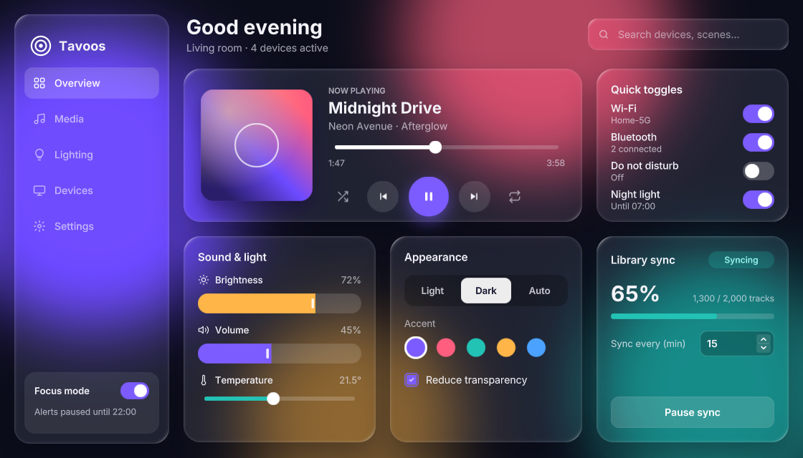
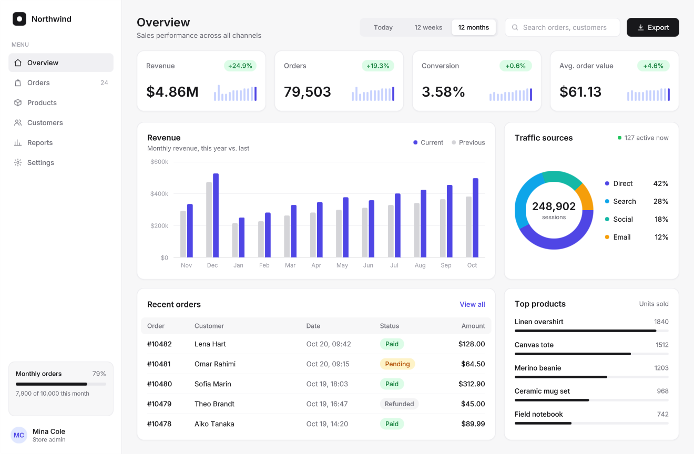
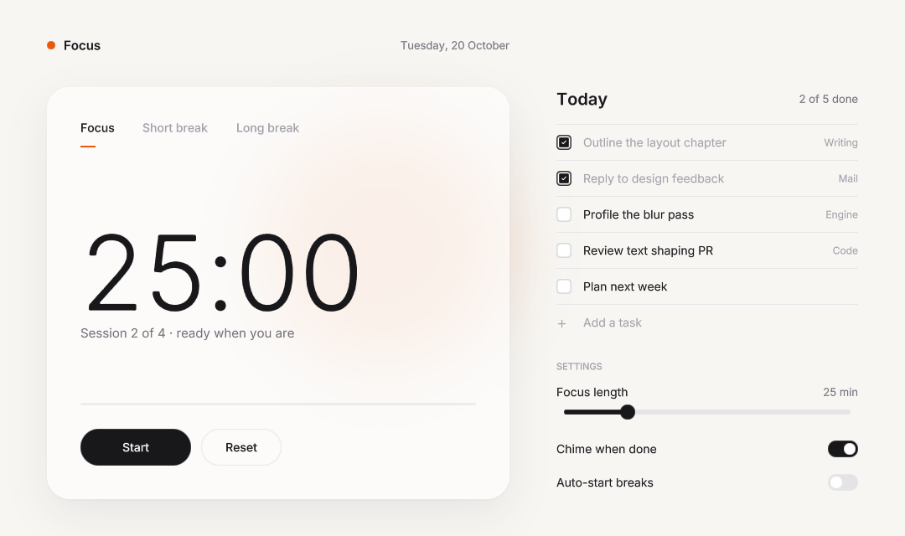

# Examples

Three sample apps built with Tavoos. They are built along with the library, and all of them embed the Inter font from `assets/fonts/` with `tavoos_add_resources()`.

## Build and run

From the repository root:

```bash
cmake -S . -B build -DCMAKE_CXX_COMPILER=g++-14 -DCMAKE_BUILD_TYPE=Release
cmake --build build -j"$(nproc)"

./build/examples/controlCenter/controlCenter
./build/examples/dashboard/dashboard
./build/examples/focus/focus
```

Pass `-DTAVOOS_BUILD_EXAMPLES=OFF` to skip them. All data in the apps is made up.

## Control Center

Frosted-glass panels over a blurred, colorful backdrop.



- `glass()` panels, `layerBlur()` backdrop blobs, drop shadows, and linear and radial gradients
- Switch, Slider, ProgressBar, SpinBox, Checkbox, TextField, and Button
- Custom controls built on `ButtonBase` and `SliderBase`: nav items, a segmented control, accent swatches, icon buttons, and fill sliders
- Reactive `State<T>`: picking an accent swatch recolors every accent-bound widget live
- `AnimatedState` for hover and press feedback, and a small `AnimatableBase` ticker that advances the song and the library sync

## Analytics dashboard

A dense, minimal store-analytics dashboard. It uses no glass, just white cards, hairline borders and one indigo accent.



- **Range switch:** a segmented control (Today / 12 weeks / 12 months) built on `ButtonBase` + `ButtonGroup`. Switching ranges animates every chart bar and sparkline (`AnimatedState<float>` bound to `heightFraction`) and updates every KPI, delta chip, axis label and total through `State<T>`.
- **Revenue chart:** a two-series bar chart made only of rectangles, gridlines and labels positioned with `yFraction` / `xFraction`
- **Donut:** a `conicGradient` with hard stops, punched out by a white disc
- **Table:** an orders table with hover rows (`onMouseEnter` / `onMouseLeave`) and status pills
- **Other widgets:** top products as `ProgressBar`s, sidebar navigation with icons and badges, a search `TextField`, and a `Button` with an SVG icon
- **Live counter:** an "active now" figure updated by a small `AnimatableBase` ticker

## Focus

A quiet focus timer with today's tasks. It uses one typeface, one accent color, and hairline borders. The only effect is a single soft glass card over a faint blurred glow.



- Custom controls on `ButtonBase`: underlined mode tabs joined in a `ButtonGroup`, and pill buttons with animated hover and press states
- A countdown driven by a small `AnimatableBase` ticker, a `ProgressBar` bound to the elapsed time, and `State<std::string>` labels
- A task list in a `ScrollArea`. Typing in the `TextField` and pressing Enter adds a row at runtime with `addChild`. Checking a box fades the row and updates the "done" count.
- A `Slider` for focus length and two `Switch`es

## Fonts

The apps share the Inter fonts in `assets/fonts/`, which are licensed under the SIL Open Font License; see `assets/fonts/LICENSE-Inter.txt`. Each app passes `BASE_DIR` to `tavoos_add_resources()` so the shared folder is embedded under the usual `resource:/assets/fonts/...` paths.
